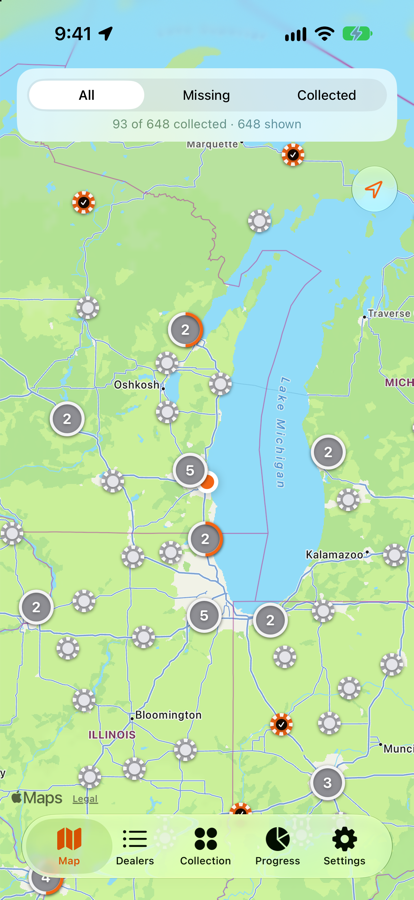
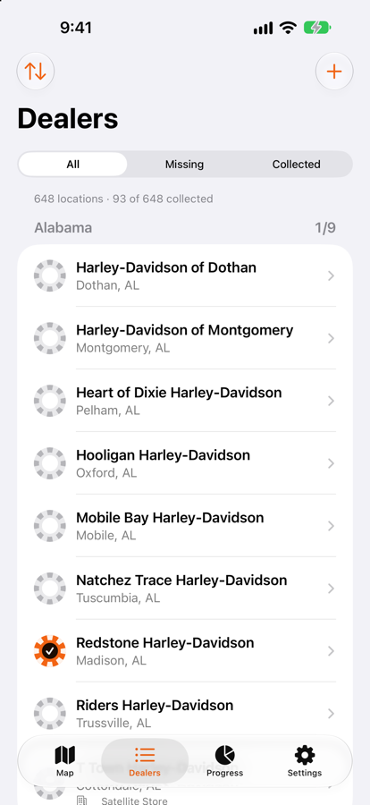
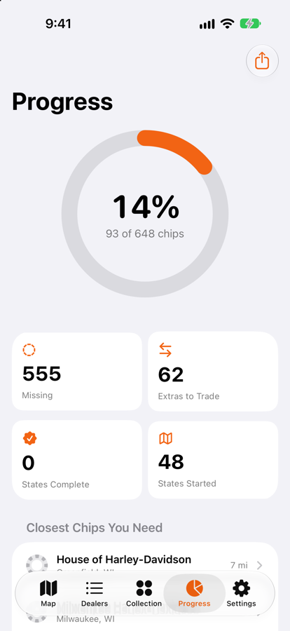
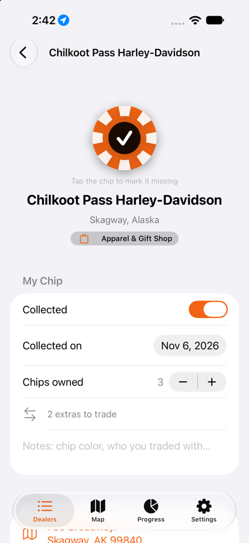
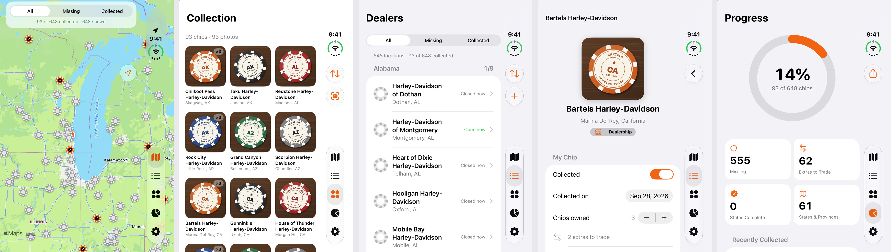
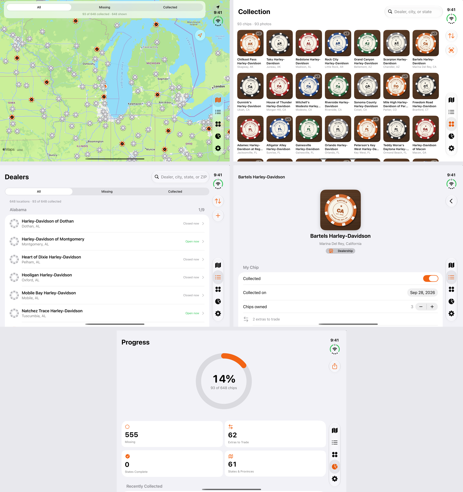

# Chip Chaser

Chip Chaser is an iPhone app for Harley-Davidson chip collectors (it started out as Harley Chip Tracker, the name the code still uses). Every Harley-Davidson dealership sells its own poker chip; this app lists them all and tracks which ones you have and which you're still missing.

<p>
  
  
  
  
</p>

On iPhone Duo's outer screen (folded), iOS moves the tab bar to a rail along the right edge; no layout changes were needed:



Unfolded, the app fills the big inner screen in landscape, with the same rail on the right:



Full-size Duo screenshots are in [`docs/appstore/duo/`](docs/appstore/duo/) (folded) and [`docs/appstore/duo-unfolded/`](docs/appstore/duo-unfolded/), next to the App Store screenshots in [`docs/appstore/`](docs/appstore/).

## Features

- **Map first.** The app opens on the map. Orange chips are ones you have, grey ones you're missing. The map centers on your area so you can plan a ride around the chips you still need.
- **Every location, built in.** 648 US and Canadian locations (556 dealerships, 26 satellite stores, 66 apparel & gift shops) from Harley-Davidson's dealer locator, including Alaska, Hawaii, Puerto Rico and Guam.
- **Snap your chips.** Take a photo of a chip (or several laid out face up) and the app reads the dealer's name off each one, on the iPhone, and adds it to your collection with its photo. You check each match first, and can pick the dealer yourself if it can't read one.
- **Your digital collection.** The Collection tab shows every chip you have, with its photo. Each dealer's page shows your chip's photo too; add, retake or remove it there.
- **Store hours.** Each location shows whether it's open right now ("Open now · closes 6 PM", "Closed · opens 9 AM Tue") and its weekly hours, read by the store's own clock, so a dealer two time zones away shows its local time. Lists mark each store open or closed now.
- **Mark chips in one tap.** Tap the chip next to a dealer, or swipe the row. Filter by All / Missing / Collected, search by name, city, state or ZIP, and sort by state, A to Z, or nearest to you.
- **Progress.** Overall percentage, per-state progress (with a seal when you finish a state), recently collected, and counts of extras.
- **Trading.** Track how many of each chip you own. Share your *missing list* or *extras for trade* as text to a collector group.
- **Your own stores.** Add a dealer that's new, closed, or overseas; it counts like any other.
- **Choose what counts.** Turn Canadian locations, satellite stores or apparel shops on or off in Settings.
- **Saved to your Apple ID.** Your collection syncs through your own iCloud account to every iPhone signed in with the same Apple ID. There's no separate sign-in; Settings shows whether iCloud is on.
- **Backup.** Export your collection as a JSON file (Files, AirDrop) and import it on any phone. The app also keeps automatic backups on the iPhone, one per day and per app version, so there's always a copy from before an update (Settings → Automatic Backups).

## iCloud sync

The SwiftData store mirrors to the private CloudKit database in `iCloud.com.nikhilmath.HarleyChipTracker` (see `HarleyChipTracker/Services/CloudSync.swift`). Each collector's data lives in their own iCloud account; the developer can't read it. Without an iCloud account the app keeps working locally and syncs once the person signs in.

CloudKit can't enforce one record per dealer, so the app merges duplicates (the same chip marked on two devices before they sync) whenever iCloud changes arrive.

**When the models change:** TestFlight and App Store builds use CloudKit's *production* environment, which only gets new record types or fields when you deploy them.

1. Bump `CloudSync.schemaVersion`, then run a Debug build on a device signed in to iCloud. It pushes the schema to the *development* environment on first launch (or pass `-initCloudKitSchema YES`).
2. In [CloudKit Console](https://icloud.developer.apple.com/dashboard), open the container and choose **Deploy Schema Changes** to production.
3. Then archive and upload the build.

Only add fields; never rename or delete one that has shipped.

## Keeping collections safe across updates

App updates keep the app's files, so a collection survives an update as long as the new build can still read it and still knows every dealer it points to. These rules make sure of that:

- **The store never moves.** It's `Library/Application Support/default.store`, where 1.0 put it (`CloudSync.storeURL`). A store at any other path opens empty.
- **Model changes only add.** New properties need a default value. Never rename, retype or remove a property that has shipped (CloudKit's production schema can't take those changes either).
- **Dealer IDs never disappear.** Chips are keyed by Harley-Davidson's dealer ID. `Tools/update_dealers.py` keeps any location that drops out of the locator, marked `"closed"`. The app keeps showing a closed location to collectors who have its chip, so closings don't take chips away or count as missing. `HarleyChipTrackerTests/Fixtures/known-dealer-ids.txt` lists every ID ever shipped, and the script refuses to drop one.
- **Tests check all of this.** `UpgradeTests` opens `Fixtures/collection-1.0.store`, a collection saved by the 1.0 App Store build, and checks that every chip, note and added store is still there and still counts. It also checks that every shipped dealer ID still resolves. If a change would strand anyone's chips, these tests fail.
- **Automatic backups are the safety net.** Each day the app is used, it saves the collection to `Application Support/Automatic Backups/` (`AutomaticBackups.swift`): one file per day and per app version, keeping the newest 14. It never saves an empty collection over a good one. Collectors can restore one from Settings.

To check an update by hand: install the App Store version on a simulator, mark some chips, install the new build over it (`xcrun simctl install booted …`) and check that the count is unchanged.

## Chip photos

Photos never touch the SwiftData store or its iCloud schema, so they can't put a single chip at risk. They're JPEG files in `Library/Application Support/Chip Photos/` (`ChipPhotoStore.swift`), one per dealer ID plus a thumbnail. App updates keep them and the iPhone's own iCloud Backup includes them, but they don't sync between iPhones through the app's iCloud sync and aren't in exported backups. Photos are only deleted when the collector removes one: marking a chip missing, resetting the collection or deleting an added store leaves them alone, so a restored backup gets its photos back.

Reading a chip runs on-device with Vision (`ChipRecognizer.swift`):

1. `ChipCircles` finds the round chips with a Hough transform and unrolls each one's rim into a flat strip, both ways round, so a dealer name curving around the edge reads as one straight line.
2. The whole photo is also read turned eight ways, for straight text on a chip lying at an angle.
3. `ChipMatcher` scores every location by how much of its name and town turns up, weighting rare words above common ones, tolerating misread letters and cut-off words, and using where the photo was taken to break ties. Several chips in one photo are found one at a time: each match claims the text that identified it.

`ChipScanTests` covers the matcher against the real dealer list and runs the recognizer on rendered chips (curved text, turned, two in one photo).

## Running it

Requirements: Xcode 16 or later (built with Xcode 27.2), iOS 18 or later.

1. Open `HarleyChipTracker.xcodeproj`.
2. Pick an iPhone simulator and press **Run**.
3. To install on your own iPhone, select the *HarleyChipTracker* target → **Signing & Capabilities** → choose your Team, then run on your device.

From the command line:

```bash
xcodebuild test -project HarleyChipTracker.xcodeproj -scheme HarleyChipTracker -destination 'platform=iOS Simulator,name=iPhone 18 Pro'
```

Debug builds accept `-demoData YES` (in-memory sample collection), `-debugTab dealers|collection|progress|settings` (the app opens on the map otherwise), `-debugDealer <id>` (with `-debugTab dealers`), and `-debugScanImage <path>` (with `-debugTab collection`: opens Add from Photo on that image; add `-debugScanAdd YES` to add what it finds) launch arguments for screenshots and simulator checks. The App Store set in `docs/appstore/` is, in order: `-demoData YES`, then adding `-debugTab collection`, `-debugTab dealers`, `-debugTab dealers -debugDealer hd-210`, and `-debugTab progress`, with the simulator's location set to Milwaukee (43.0389, -87.9065) and the status bar at 9:41. `Tools/capture_screenshots.sh <simulator> <out dir> [display]` takes the whole set. It fills the demo collection's photos with original stand-in chips drawn by `Tools/make_demo_chip_photos.swift` (not any real chip design).

## Releasing to TestFlight

Releases happen on GitHub. Every push to `main` that changes the app (`HarleyChipTracker/`, `Config/` or the Xcode project) runs the [Release workflow](.github/workflows/release.yml) on GitHub's Xcode 27 runner. It:

1. picks the next build number: one more than the highest `v*-build<N>` tag (`Tools/next-build-number.sh`);
2. archives the app with that build number, using an App Store Connect API key so Xcode can handle signing in the cloud;
3. checks that the iCloud entitlement made it into the archive;
4. uploads the build to App Store Connect;
5. tags the commit `v<version>-build<N>` and publishes a [GitHub Release](https://github.com/NikhilMath/Chip-Chaser/releases) listing the commits since the last build (`Tools/github-release.sh`).

Changes to docs, tests and tools don't trigger a build. To release by hand, open **Actions → Release → Run workflow**, or run `gh workflow run release.yml`. When Apple finishes processing a build, add it to a group in App Store Connect → TestFlight. The **Friends** group has the public link, and Apple has to review its builds.

After a version is live on the App Store, Apple won't take new builds for it. Raise `MARKETING_VERSION` (say, to 1.1) before the next release. The build number in the project file stays put; the tags are the record.

### The App Store Connect key

The workflow needs three repository secrets. Until they're set, it only checks that the app compiles.

1. In [App Store Connect → Users and Access → Integrations](https://appstoreconnect.apple.com/access/integrations/api), generate a **Team Key** with the **Admin** role. Admin is what lets Xcode create signing certificates and profiles on GitHub's machines.
2. Download the `AuthKey_XXXXXXXXXX.p8` file. Apple only lets you download it once.
3. Add the secrets:

   ```bash
   gh secret set ASC_KEY_ID --body XXXXXXXXXX
   gh secret set ASC_ISSUER_ID --body 00000000-0000-0000-0000-000000000000
   gh secret set ASC_KEY_P8 < ~/Downloads/AuthKey_XXXXXXXXXX.p8
   ```

The Key ID is shown next to the key, and the Issuer ID is at the top of that page.

### From this Mac

```bash
Tools/release.sh
```

This is the fallback when GitHub can't run. It does the same thing using the Apple account signed in to Xcode: it only runs when everything is committed and on `origin/main`, then archives, uploads with `Config/ExportOptions.plist` and publishes the GitHub Release.

Working with Claude Code in this repo, a Stop hook (`.claude/hooks/require-pushed.sh`) won't let a turn end while changes are uncommitted or commits aren't on `origin/main`. It also flags when app changes haven't been released and the latest Release workflow run failed.

## Updating the dealer list

Dealers open, close and get renamed. To refresh the bundled list:

```bash
pip3 install timezonefinder   # once
python3 Tools/update_dealers.py
```

The script runs about 150 radius searches against Harley-Davidson's public dealer locator, de-duplicates them, and rewrites `HarleyChipTracker/Resources/dealers.json`, keeping only the fields the app uses. That includes each location's opening hours (seven strings, Sunday first: `"closed"` or `"09:00-18:00"`) and its IANA time zone, which `timezonefinder` works out from the coordinates so split states like South Dakota or Tennessee come out right. Without `timezonefinder`, time zones carry over from the previous list. A few seasonal shops list every day as closed off-season; the script leaves their hours out rather than show them as closed for good. Chip records are keyed by Harley-Davidson's dealer ID. Locations that have left the locator stay in the file, marked `"closed"` with the date they went missing, so a refresh never takes a chip out of anyone's collection. New IDs are added to `HarleyChipTrackerTests/Fixtures/known-dealer-ids.txt`; commit both files together.

## Project layout

```
HarleyChipTracker/
  App/          App entry point and AppModel (tracking settings, location)
  Models/       Dealer, ChipRecord / CustomDealer (SwiftData), region names
  Data/         Bundled directory loader, collection status, backup, share text
  Services/     One-shot location provider, iCloud sync and account status
  Views/        Dealers, Map, Progress, Settings, detail and add-store screens
  Resources/    dealers.json
HarleyChipTrackerTests/   Swift Testing suite; Fixtures/ holds a 1.0 collection and every shipped dealer ID
Config/         Entitlements (iCloud, push), Info.plist additions, TestFlight export options
Tools/          update_dealers.py, make_icon.swift (app icon), next-build-number.sh,
                github-release.sh (tag and publish a GitHub Release), release.sh (upload from this Mac)
.github/        Release workflow (build and upload on every app change)
```

## Disclaimer

Chip Chaser is an independent fan project. It is not affiliated with, sponsored by, or endorsed by Harley-Davidson. Harley-Davidson and related marks are trademarks of H-D U.S.A., LLC. Location data comes from Harley-Davidson's public dealer locator.
